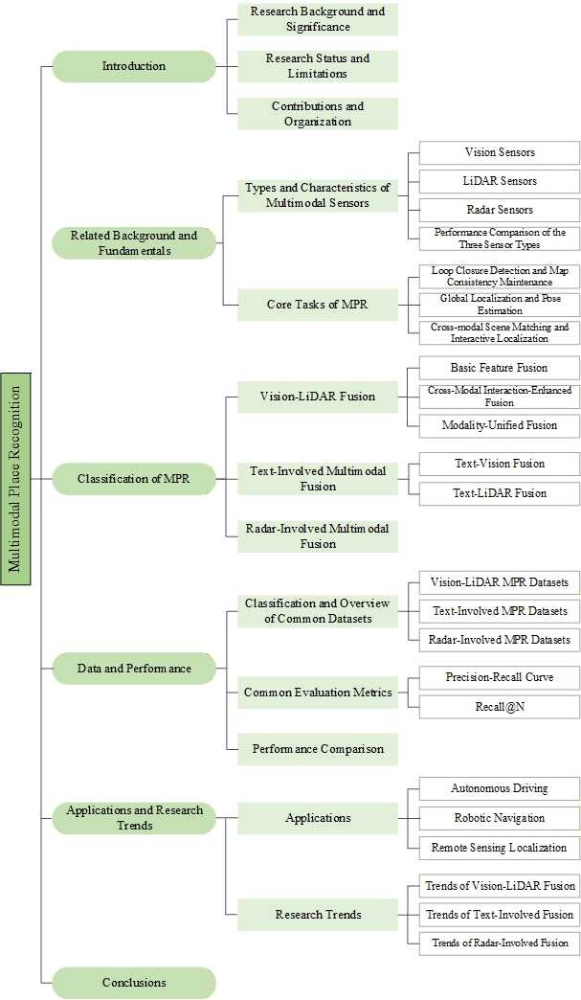

> # Multimodal Place Recognition: Fusion Paradigms, Benchmarks, and Open Challenges
This paper presents a systematic review of multimodal place recognition research.
## Abstract
Place recognition provides global localization cues for Simultaneous Localization and Mapping (SLAM) and serves as a key enabler for autonomous vehicles and mobile robots. However, place recognition approaches dominated by a single sensor modality are inherently constrained by modality-specific limitations, making it difficult to simultaneously satisfy the requirements of accuracy, robustness, and generalization in complex environments. multimodal information fusion has emerged as a mainstream paradigm for overcoming the performance bottlenecks of unimodal methods. Despite the rapid development of this field, a comprehensive survey dedicated to multimodal place recognition (MPR) remains lacking. To bridge this gap, this paper presents a systematic review of MPR research. We first analyze the performance characteristics and complementary properties of core sensing modalities, and clarify their fundamental task formulations. We then establish three representative paradigms from a fusion-oriented perspective: (1) vision-LiDAR fusion, (2) text-involved multimodal fusion, (3) radar-involved multimodal fusion, and (4) other multimodal fusion methods. we further provide an indepth analysis of their fundamental principles, representative methods, advantages, and limitations. Subsequently, we systematically organize commonly used benchmark datasets, introduce core evaluation metrics, and conduct a comparative analysis of representative approaches. Finally, we discuss the practical significance of MPR in autonomous driving, robotic navigation, and remote sensing-based localization, and outline promising research directions for future exploration.
## Survey Overview
This paper provides a comprehensive review of recent advancements in mutimodal place recognition, focusing on five key methodological paradigms:

1.Vision-LiDAR Fusion

2.Text-Vision Fusion

3.Text-LiDAR Fusion

4.Radar-Assisted Fusion

5.Other Multimodal Fusion

<!--  -->

##  Structure of MPR-Survey

## All the methods are listed below:
### 1.  Vision-LiDAR Fusion
#### 1. 1 Basic Feature Fusion
| No. | Title | First Author | Venue | Github |
|--|--|--|--|--|
|1| [Robust place recognition based on multi-sensor fusion](https://ieeexplore.ieee.org/stamp/stamp.jsp?tp=&arnumber=9588194) | Hao Gu | CYBER|  |
|2| [Large-scale place recognition based on camera-lidar fused descriptor](https://www.mdpi.com/1424-8220/20/10/2870) | Shaorong Xie | Sensors |  |
|3| [MinkLoc++: Lidar and monocular image fusion for place recognition](https://ieeexplore.ieee.org/stamp/stamp.jsp?tp=&arnumber=9533373) | Jacek Komorowski | IJCNN | [Github](https://github.com/jac99/MinkLocMultimodal) |
|4| [MMDF: Multi-modal deep feature based place recognition of mobile robots with applications on cross-scene navigation](https://ieeexplore.ieee.org/stamp/stamp.jsp?tp=&arnumber=9781852) | Xiang Yu | IEEE Robotics and Automation Letters |  |
|5| [A Fast LiDAR Place Recognition Descriptor Based on Density Classification and Multi-Modal Fusion Place Recognition Strategy](https://ieeexplore.ieee.org/stamp/stamp.jsp?tp=&arnumber=11155160) | Guoliang Yu | IEEE Robotics and Automation Letters |  |
|6| [An adaptive network fusing light detection and ranging height-sliced bird’s-eye view and vision for place recognition](https://www.sciencedirect.com/science/article/pii/S0952197624013885) | Rui Zheng | Engineering Applications of Artificial Intelligence | [Github](https://github.com/Bryan-ZhengRui/LocFuse) |
#### 1. 2 Cross-Modal Interaction-Enhanced Fusion
| No. | Title | First Author | Venue | Github |
|--|--|--|--|--|
|1|[PIC-Net: Point cloud and image collaboration network for large-scale place recognition](https://arxiv.org/pdf/2008.00658) | Yuheng Lu | arXiv |  |
|2| [Adafusion: Visual-lidar fusion with adaptive weights for place recognition](https://ieeexplore.ieee.org/stamp/stamp.jsp?tp=&arnumber=9905898) | Haowen Lai | IEEE Robotics and Automation Letters |  |
|3| [Spherical multi-modal place recognition for heterogeneous sensor systems](https://ieeexplore.ieee.org/stamp/stamp.jsp?tp=&arnumber=9561078) | Lukas Bernreiter | ICRA |  |
|4| [Attention-enhanced cross-modal localization between spherical images and point clouds](https://ieeexplore.ieee.org/stamp/stamp.jsp?tp=&arnumber=10227896) | Zhipeng Zhao | IEEE Sensors Journal | [Github](https://github.com/Zhaozhpe/AE-CrossModal) |
|5| [Transformer Based Multi-modal Fusion For Place Recognition with Self-attention Mechanism](https://ieeexplore.ieee.org/stamp/stamp.jsp?tp=&arnumber=10055623) | Yan Pan | CAC |  |
|6| [Camera-LiDAR fusion with latent correlation for cross-scene place recognition](https://ieeexplore.ieee.org/stamp/stamp.jsp?tp=&arnumber=10665753) | Yan Pan | IEEE Transactions on Industrial Electronics |  |
|7| [Lcpr: A multi-scale attention-based lidar-camera fusion network for place recognition](https://ieeexplore.ieee.org/stamp/stamp.jsp?tp=&arnumber=10373064) | Zijie Zhou | IEEE Robotics and Automation Letters | [Github](https://github.com/ZhouZijie77/LCPR) |
|8| [PRFusion: Toward effective and robust multi-modal place recognition with image and point cloud fusion](https://ieeexplore.ieee.org/stamp/stamp.jsp?tp=&arnumber=10704955) | Sijie Wang | IEEE Transactions on Intelligent Transportation Systems |  |
|9| [Explicit interaction for fusion-based place recognition](https://ieeexplore.ieee.org/stamp/stamp.jsp?tp=&arnumber=10802665) | Jingyi Xu | IROS | [Github](https://github.com/BIT-XJY/EINet) |
|10| [BdFusion: Bi-directional visual-LiDAR fusion for resilient place recognition](https://www.sciencedirect.com/science/article/abs/pii/S0924271625002849) | Anbang Liang | ISPRS Journal of Photogrammetry and Remote Sensing | [Github](https://github.com/ThomasLiangAB/BdFusion) |
|11| [Lip-loc: Lidar image pretraining for cross-modal localization](https://openaccess.thecvf.com/content/WACV2024W/LLVM-AD/papers/Shubodh_LIP-Loc_LiDAR_Image_Pretraining_for_Cross-Modal_Localization_WACVW_2024_paper.pdf) | Sai Shubodh Puligilla | WACV |  |
|12|  [Contrastive learning-based place descriptor representation for cross-modality place recognition](https://www.sciencedirect.com/science/article/pii/S1566253525004245)| Shiyu Meng | Information Fusion | [Github](https://github.com/emilyemliyM/Cross-PRNet) |
|13| [InsCMPR: Efficient Cross-Modal Place Recognition via Instance-Aware Hybrid Mamba-Transformer](https://ieeexplore.ieee.org/stamp/stamp.jsp?tp=&arnumber=11128210) | Shuaifeng Jiao | ICRA | [Github](https://github.com/nubot-nudt/InsCMPR) |
|14| [CrossBEV-PR: Cross-modal Visual-LiDAR Place Recognition via BEV Feature Distillation](https://ieeexplore.ieee.org/stamp/stamp.jsp?tp=&arnumber=11246576) | Jianbo Xu | IROS | [Github](https://github.com/IRMVLab/CrossBEV-PR) |
|15| [A hierarchical and multi-modal framework for place recognition with a learnable metric](https://ieeexplore.ieee.org/stamp/stamp.jsp?tp=&arnumber=10508992) | Chengfu Shu | IEEE Transactions on Intelligent Vehicles | [Github](https://github.com/hhuscf/HMPR) |
|16| [Unifying local and global multimodal features for place recognition in aliased and low-texture environments](https://ieeexplore.ieee.org/abstract/document/10611563/)| Alberto García-Hernández | ICRA | [Github](https://github.com/DLR-RM/UMF) |
|17| [VXP: Voxel-Cross-Pixel Large-Scale Camera-LiDAR Place Recognition](https://ieeexplore.ieee.org/stamp/stamp.jsp?tp=&arnumber=11125591) | YunJin Li | 3DV |[Github](https://github.com/yunjinli/vxp) |
|18|[VGGT-MPR: VGGT-Enhanced Multimodal Place Recognition in Autonomous Driving Environments](https://arxiv.org/pdf/2602.19735) | Jingyi Xu | arXiv |  |
#### 1. 3 Modality-Unified Fusion
| No.| Title | First Author | Venue | Github |
|--|--|--|--|--|
|1| [Global visual localization in LiDAR-maps through shared 2D-3D embedding space](https://ieeexplore.ieee.org/abstract/document/9196859/) | D. Cattaneo | ICRA |  |
|2| [Coral: Colored structural representation for bi-modal place recognition](https://ieeexplore.ieee.org/stamp/stamp.jsp?tp=&arnumber=9635839)| Yiyuan Pan | IROS | [Github](https://github.com/Panyiyuan96/CORAL_Pytorch) |
|3| [I2d-loc: Camera localization via image to lidar depth flow](https://www.sciencedirect.com/science/article/pii/S0924271622002775)| Kuangyi Chen| Journal of Photogrammetry and Remote Sensing | [Github](https://levenberg.github.io/I2D-Loc/) |
|4| [I2p-rec: Recognizing images on large-scale point cloud maps through bird's eye view projections](https://ieeexplore.ieee.org/stamp/stamp.jsp?tp=&arnumber=10341907) | Shuhang Zheng | IROS |  |
|5| [Cross-modal visual relocalization in prior lidar maps utilizing intensity textures](https://ieeexplore.ieee.org/stamp/stamp.jsp?tp=&arnumber=10801498)| Qiyuan Shen | IROS |  |
|6| [Range and Bird's Eye View Fused Cross-Modal Visual Place Recognition](https://ieeexplore.ieee.org/stamp/stamp.jsp?tp=&arnumber=11097657) | Jianyi Peng | IV |  |
|7| [CrossGLoc: Cross-Modal Global Localization Leveraging Pretrained Diffusion Models and Semantic Cues for Intelligent Vehicles](https://ieeexplore.ieee.org/stamp/stamp.jsp?tp=&arnumber=11106394) | Hengwang Zhao | IEEE Transactions on Intelligent Transportation Systems |  |
|8| [(LC)2: LiDAR-camera loop constraints for cross-modal place recognition](https://ieeexplore.ieee.org/stamp/stamp.jsp?tp=&arnumber=10105996) | Alex Junho Lee | IEEE Robotics and Automation Letters |  |
|9|  [Modalink: Unifying modalities for efficient image-to-pointcloud place recognition](https://ieeexplore.ieee.org/stamp/stamp.jsp?tp=&arnumber=10801556)| Weidong Xie | IROS | [Github](https://github.com/haomo-ai/ModaLink) |
|10| [Rgb2lidar: Towards solving large-scale cross-modal visual localization](https://dl.acm.org/doi/epdf/10.1145/3394171.3413647) | Niluthpol Chowdhury Mithun | ACM MM | [Github](https://github.com/niluthpol/RGB2LIDAR) |
|11| [C2l-pr: Cross-modal camera-to-lidar place recognition via modality alignment and orientation voting](https://ieeexplore.ieee.org/stamp/stamp.jsp?tp=&arnumber=10586273) |Huaiyuan Xu |IEEE Transactions on Intelligent Vehicles| [Github](https://github.com/lab-sun/C2L-PR) |
|12|[i3dLoc: Image-to-range cross-domain localization robust to inconsistent environmental conditions](https://arxiv.org/abs/2105.12883)|Peng Yin |arXiv| |
|13| [Cross-Modal 2D-3D Localization with Single-Modal Query](https://ieeexplore.ieee.org/stamp/stamp.jsp?tp=&arnumber=10282358) | Zhipeng Zhao | IGARSS |  |
|14| [Monocular visual place recognition in lidar maps via cross-modal state space model and multi-view matching](https://ieeexplore.ieee.org/stamp/stamp.jsp?tp=&arnumber=11128591)| Gongxin Yao | ICRA | [Github](https://github.com/y2w-oc/I2P-CMPR) |
|15| [GSPR: Multimodal place recognition using 3D Gaussian splatting for autonomous driving](https://ieeexplore.ieee.org/abstract/document/11247374/)| Zhangshuo Qi | IROS | [Github](https://github.com/QiZS-BIT/GSPR) |
### 2.  Text-Vision Fusion
|No.| Title | First Author | Venue | Github |
|--|--|--|--|--|
|1|[TextPlace: Visual place recognition and topological localization through reading scene texts](https://ieeexplore.ieee.org/abstract/document/9010336/)| Ziyang Hong | ICCV | |
|2|[Textinplace: Indoor visual place recognition in repetitive structures with scene text spotting and verification](https://ieeexplore.ieee.org/abstract/document/11247364/)| Huaqi Tao| IROS|  [Github](https://github.com/HqiTao/TextInPlace)|
|3| [FM-Loc: Using Foundation Models for Improved Vision Based Localization](https://ieeexplore.ieee.org/stamp/stamp.jsp?tp=&arnumber=10342439)| Reihaneh Mirjalili |IROS|  |
|4| [Context Graph-Based Visual-Language Place Recognition](https://ieeexplore.ieee.org/stamp/stamp.jsp?tp=&arnumber=11127699) | Soojin Woo |  ICRA| [Github](https://github.com/woo-soojin/context-based-vlpr) |
|5| [Tell me where you are: Multimodal llms meet place recognition](https://arxiv.org/pdf/2406.17520)| Zonglin Lyu | arXiv | [Github](https://github.com/ai4ce/LLM4VPR) |
|6| [Guiding Multimodal LLMs for Efficient Visual Place Recognition](https://www.sciencedirect.com/science/article/pii/S0167865526000413)| Zhijian He|Pattern Recognition Letters|  |
|7| [InternVL-VPR: Hierarchical Zero-Shot Visual Place Recognition with VLM-Driven Re-Ranking](https://ieeexplore.ieee.org/stamp/stamp.jsp?tp=&arnumber=11249210)| Zhi Hu |APSIPA ASC|  |
|8| [“where am i?” scene retrieval with language](https://link.springer.com/chapter/10.1007/978-3-031-72913-3_12) | Jiaqi Chen | ECCV | [Github](https://github.com/jiaqchen/whereami-text2sgm) |
|9| [MSSPlace: Multi-sensor place recognition with visual and text semantics](https://ieeexplore.ieee.org/stamp/stamp.jsp?tp=&arnumber=11195136) | Alexander Melekhin| IEEE Access | [Github](https://github.com/alexmelekhin/MSSPlace) |
|10| [Text2Graph VPR: A Text-to-Graph Expert System for Explainable Place Recognition in Changing Environments](https://arxiv.org/pdf/2512.18613)| Saeideh Yousefzadeh |arXiv  |  |
|11|[Progeo: Generating prompts through image-text contrastive learning for visual geo-localization](https://link.springer.com/chapter/10.1007/978-3-031-72338-4_30)| Jingqi Hu |ICANN |[GitHub](https://github.com/Chain-Mao/ProGEO)  |
|12|[Bridging text and vision: a multi-view text-vision registration approach for cross-modal place recognition](https://ieeexplore.ieee.org/stamp/stamp.jsp?tp=&arnumber=11246871) | Tianyi Shang | IROS | [Github](https://github.com/nuozimiaowu/Text4VPR) |
|13| [LVLM-empowered Multi-modal Representation Learning for Visual Place Recognition](https://arxiv.org/pdf/2407.06730)| Teng Wang |arXiv  |  |
|14|[DiffPlace: Street View Generation via Place-Controllable Diffusion Model Enhancing Place Recognition](https://arxiv.org/abs/2602.11875)| Ji Li |arXiv  | [Github](https://jerichoji.github.io/DiffPlace/) |
|15| [Mms-vpr: Multimodal street-level visual place recognition dataset and benchmark](https://arxiv.org/pdf/2505.12254) | Yiwei Ou | arXiv | [Github](https://github.com/yiasun/MMS-VPRlib) |
|16|[Lavpr: Benchmarking language and vision for place recognition](https://link.springer.com/chapter/10.1007/978-3-032-37281-9_22)| Ofer Idan | ECCV | [Github](https://github.com/oferidan1/LaVPR)|

### 3.  Text–LiDAR Fusion

|No.| Title | First Author | Venue | Github |
|--|--|--|--|--|
|1| [Text2pos: Text-to-point-cloud cross-modal localization](https://openaccess.thecvf.com/content/CVPR2022/papers/Kolmet_Text2Pos_Text-to-Point-Cloud_Cross-Modal_Localization_CVPR_2022_paper.pdf) | Manuel Kolmet | CVPR | [Github](https://github.com/mako443/Text2Pos-CVPR2022) |
|2| [Text to point cloud localization with relation-enhanced transformer](https://ojs.aaai.org/index.php/AAAI/article/view/25347) | Guangzhi Wang | AAAI | |
|3| [Text2loc: 3d point cloud localization from natural language](https://openaccess.thecvf.com/content/CVPR2024/papers/Xia_Text2Loc_3D_Point_Cloud_Localization_from_Natural_Language_CVPR_2024_paper.pdf)| Yan Xia | CVPR | [Github](https://github.com/Yan-Xia/Text2Loc) |
|4|[Vehicle-SceneInteraction: A Text-Driven 3-D Lidar Place Recognition Method for Autonomous Driving](https://ieeexplore.ieee.org/abstract/document/11456443/)| Tianyi Shang | Transactions on Intelligent Transportation Systems | [Github](https://github.com/nuozimiaowu/Des4Pos)|
|5|  [Mambaplace: Text-to-point-cloud cross-modal place recognition with attention mamba mechanisms](https://ieeexplore.ieee.org/stamp/stamp.jsp?tp=&arnumber=11246747)| Tianyi Shang |  IROS| [Github](https://github.com/nuozimiaowu/MambaPlace) |
|6| [FourierPlace: A Vision-Language Localization Framework Based on Frequency Domain Representations](https://ieeexplore.ieee.org/stamp/stamp.jsp?tp=&arnumber=11260932)| Tianyi Shang | IEEE Robotics and Automation Letters | |
|7|[Riemannian and Symplectic Geometry for Hierarchical Text-Driven Place Recognition](https://arxiv.org/abs/2604.01598)| Tianyi Shang | arXiv | |
|8|[SpatiaLoc: Leveraging Multi-Level Spatial Enhanced Descriptors for Cross-Modal Localization](https://arxiv.org/abs/2601.03579)| Tianyi Shang | arXiv | |
|9| [Instance-free text to point cloud localization with relative position awareness](https://arxiv.org/pdf/2404.17845)| Lichao Wang |arXiv  |  |
|10|[CMMLoc: Advancing Text-to-PointCloud Localization with Cauchy-Mixture-Model Based Framework](https://openaccess.thecvf.com/content/CVPR2025/papers/Xu_CMMLoc_Advancing_Text-to-PointCloud_Localization_with_Cauchy-Mixture-Model_Based_Framework_CVPR_2025_paper.pdf) | Yanlong Xu | CVPR | [Github](https://github.com/kevin301342/CMMLoc) |
|11| [Text to Point Cloud Localization with Multi-Level Negative Contrastive Learning](https://ojs.aaai.org/index.php/AAAI/article/view/32574) | Dunqiang Liu | AAAI | [Github](https://github.com/dqliua/MNCL) |
|12| [Text-guided scene perception cross-modal place recognition for remote sensing localization](https://www.sciencedirect.com/science/article/pii/S1566253525009297) | Mo Yang | Information Fusion |  |
|13| [Text2Loc++: Generalizing 3D Point Cloud Localization from Natural Language](https://arxiv.org/pdf/2511.15308)| Yan Xia | Transactions on Pattern Analysis and Machine Intelligence|  |
|14| [ VLM-Loc: Localization in Point Cloud Maps via Vision-Language Models](https://arxiv.org/pdf/2603.09826) | Shuhao Kang| arXiv |  |

### 4.  Radar-Assisted Fusion
|No.| Title | First Author | Venue | Github |
|--|--|--|--|--|
|1|[Rsl-net: Localising in satellite images from a radar on the ground](https://ieeexplore.ieee.org/stamp/stamp.jsp?tp=&arnumber=8957240) | Tim Yuqing Tang | IEEE Robotics and Automation Letters |  |
|2|[Radar-on-lidar: metric radar localization on prior lidar maps](https://ieeexplore.ieee.org/abstract/document/9303291/) |Huan Yin| RCAR |  |
|3| [Radar style transfer for metric robot localisation on lidar maps](https://ietresearch.onlinelibrary.wiley.com/doi/epdf/10.1049/cit2.12112) | Huan Yin | CAAI Transactions on Intelligence Technology |  |
|4| [Rall: end-to-end radar localization on lidar map using differentiable measurement model](https://ieeexplore.ieee.org/stamp/stamp.jsp?tp=&arnumber=9370010) | Huan Yin | IEEE Transactions on Intelligent Transportation Systems | [Github](https://github.com/HuanYin94/RaLL) |
|5| [Improved radar localization on lidar maps using shared embedding](https://arxiv.org/abs/2106.10000)|Huan Yin | arXiv | |
|6|  [Radar-to-lidar: Heterogeneous place recognition via joint learning](https://www.frontiersin.org/journals/robotics-and-ai/articles/10.3389/frobt.2021.661199/full)|Huan Yin | Frontiers in Robotics and AI | [Github](https://github.com/HuanYin94/radar-to-lidar-place-recognition) |
|7|[Rolm: Radar on lidar map localization](https://ieeexplore.ieee.org/abstract/document/10161203/)| Yukai Ma |ICRA|  |
|8| [RaLF: Flow-based global and metric radar localization in LiDAR maps](https://ieeexplore.ieee.org/stamp/stamp.jsp?tp=&arnumber=10610626)| Abhijeet Nayak| ICRA | [Github](https://github.com/robot-learning-freiburg/RaLF) |
|9| [Crplace: Camera-radar fusion with bev representation for place recognition](https://ieeexplore.ieee.org/stamp/stamp.jsp?tp=&arnumber=10802267)| Shaowei Fu| IROS |  |
|10| [SHeRLoc: Synchronized Heterogeneous Radar Place Recognition for Cross-Modal Localization](https://ieeexplore.ieee.org/stamp/stamp.jsp?tp=&arnumber=11206409) |  Hanjun Kim| IEEE Robotics and Automation Letters |  |
|11| [LRFusionPR: A Polar BEV-Based LiDAR-Radar Fusion Network for Place Recognition](https://ieeexplore.ieee.org/stamp/stamp.jsp?tp=&arnumber=11177016) | Zhangshuo Qi |IEEE Robotics and Automation Letters  | [Github](https://github.com/QiZS-BIT/LRFusionPR) |
|12|[Unimpr: A unified framework for multimodal place recognition with heterogeneous sensor configurations](https://ieeexplore.ieee.org/abstract/document/11740952/)| Zhangshuo Qi| Transactions on Automation Science and Engineering | [GitHub](https://github.com/QiZS-BIT/UniMPR) |

### 4.  Other Multimodal Fusion Methods
|No.| Title | First Author | Venue | Github |
|--|--|--|--|--|
|1|[Learning to find the optimal correspondence between SAR and optical image patches](https://ieeexplore.ieee.org/stamp/stamp.jsp?tp=&arnumber=10286162) |Haoyuan Li |IEEE Journal of Selected Topics in Applied Earth Observations and Remote Sensing |[Github](https://github.com/Collebt/CMPC)|
|2|[RGB-Thermal Visual Place Recognition via Vision Foundation Model](https://ieeexplore.ieee.org/stamp/stamp.jsp?tp=&arnumber=11247479)|Minghao Ye|IROS| [Github](https://github.com/HITSZ-NRSL/RGB-Thermal-VPR) |
|3|[Multi-modal aerial-ground cross-view place recognition with neural odes](https://openaccess.thecvf.com/content/CVPR2025/papers/Wang_Multi-Modal_Aerial-Ground_Cross-View_Place_Recognition_with_Neural_ODEs_CVPR_2025_paper.pdf) |Sijie Wang| CVPR|  |
|4|[GOTPR: General outdoor text-based place recognition using scene graph retrieval with openstreetmap](https://ieeexplore.ieee.org/abstract/document/10993325/)|Donghwi Jung|Robotics and Automation Letters| [Github](https://donghwijung.github.io/GOTPR_page/) |
